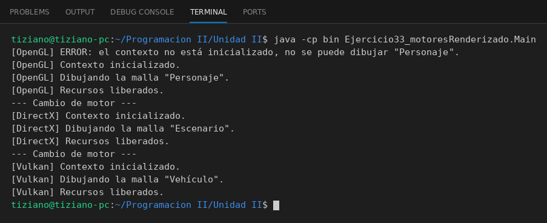

# MotorGrafico

Programación II - Unidad 2 - Ejercicio 33

## Consigna
Un ciclo gráfico que intercambia motores de renderizado mediante una variable de tipo interfaz.

## Lógica
- Interfaz `MotorGrafico` con `inicializarContexto()`, `dibujarMalla(nombre)` y `liberarRecursos()`.
- `RenderizadorOpenGL`, `RenderizadorDirectX` y `RenderizadorVulkan` mantienen el estado del contexto; dibujar sin inicializar muestra un error.
- `Main`: una sola variable `MotorGrafico` a la que se asignan los tres motores.

## Ejecución

